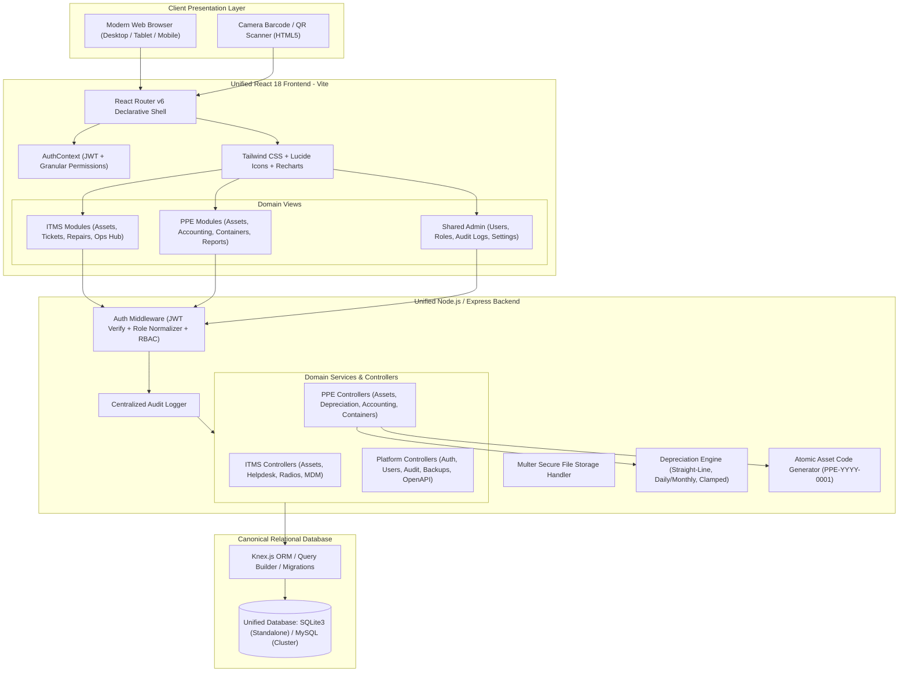

# Unified Architecture Document
## Unified ITMS + PPE Enterprise Application

---

## 1. Executive Architecture Summary

The Unified ITMS + PPE Enterprise System consolidates two previously disparate corporate business systems:
1. **ITMS (IT Management System)**: IT hardware, software licenses, network infrastructure, peripheral devices, employee assignments, preventive maintenance, repair tracking, and ticketing service desk.
2. **PPE (Property, Plant, and Equipment)**: Capital asset registry, straight-line depreciation engine with residual value floors, double-entry General Ledger (GL) journal generation, maintenance logs, and returnable container movement tracking.

Rather than implementing a superficial dashboard wrapper or portal that forwards between disparate apps, the system is engineered as a **Unified Modular Monolith**. It runs a single Express.js backend, a single unified React 18 frontend Single Page Application (SPA), a shared authentication/authorization engine, and a unified relational database schema managed via Knex.js.

---

## 2. System Architecture Diagram

---

## 3. Technology Stack Evaluation & Rationale

| Layer | Selected Technology | Alternative Considered | Selection Rationale |
| :--- | :--- | :--- | :--- |
| **Frontend Framework** | React 18 + Vite | Next.js / Vue 3 | Leverages existing ITMS component library while providing instant Hot Module Replacement (HMR) and optimized rollup production bundles. |
| **Styling & Design** | Tailwind CSS | Bootstrap / Raw CSS | Utility-first styling provides deterministic UI consistency, responsive mobile layouts, and uniform design tokens. |
| **Backend Runtime** | Node.js (v18 - v26) | Python FastAPI / Go | Preserves extensive business logic in both source codebases, simplifies unified process orchestration, and reduces deployment friction. |
| **Backend Framework** | Express.js | NestJS / Fastify | Robust middleware ecosystem (CORS, Helmet, Rate Limiter, Multer) and seamless integration with existing ITMS controllers. |
| **Database Engine** | SQLite3 (Dev/Standalone) / MySQL2 (Cluster) | PostgreSQL / MongoDB | SQLite provides zero-dependency, self-contained file persistence ideal for single-node deployments; Knex abstraction allows seamless switching to MySQL/MariaDB for clustered multi-node setups without altering SQL logic. |
| **Database ORM** | Knex.js | Prisma / Sequelize | Native schema migration lifecycle, cross-database query builder, high performance, and explicit control over transactions and locking. |
| **Authentication** | JSON Web Tokens (JWT) + Bcrypt | OAuth2 / Session Cookies | Stateless, scalable token distribution supporting web browsers and mobile scan clients. Single login endpoint accepts either `username` or `email`. |

---

## 4. Domain Module Boundaries

The application enforces clear separation between domains while sharing core infrastructural primitives:

### 4.1. Shared Platform Core (`backend/src/`)
- `middleware/auth.js`: Unified authentication and role/permission authorization.
- `routes/auth.js`: Universal dual login (`username` or `email`), token refresh, password resets, and user profile management.
- `utils/auditLogger.js`: Centralized audit logging capturing user, IP address, module, record ID, and change diffs.
- `config/db.js`: Unified connection pool and Knex configuration.
- `config/swagger.js`: OpenAPI 3.0 interactive API documentation at `/docs`.

### 4.2. ITMS Domain Modules (`backend/src/routes/`)
- `assets.js`, `twoWayRadios.js`: IT hardware tracking, specifications, assigned owners, locations, and warranties.
- `tickets.js`: Help desk service requests, incident tracking, status workflows, priorities, and assignments.
- `repairs.js`, `maintenance.js`: Repair work orders, parts utilization, and recurring maintenance schedules.
- `inventory.js`, `licenses.js`: Spare parts consumable inventory and software license key management.
- `backups.js`, `endpoints.js`, `network.js`, `printers.js`, `fileShares.js`, `guestWifi.js`, `websites.js`, `remoteManagement.js`, `webFiltering.js`: Enterprise IT operations and infrastructure monitoring.

### 4.3. PPE Domain Modules (`backend/src/routes/ppe/`)
- `ppeAssets.js`: Capital asset inventory (Category, acquisition cost, useful life, residual value, serial number, photo, QR code).
- `ppeDashboard.js`: Financial executive summary (Gross Book Value, Net Book Value, Accumulated Depreciation, Monthly Run-Rate, 12-Month Projection).
- `ppeAccounting.js`: Chart of Accounts, manual double-entry balanced Journal Vouchers (JVs), and automated monthly depreciation posting.
- `ppeContainers.js`: Returnable container tracking (Pallets, Crates, Totes) with inbound/outbound movement logging.
- `ppeReports.js`: Dynamic Excel (`.xlsx`) and PDF export of fixed asset registers.
- `ppeMaintenance.js`: Industrial and facility equipment maintenance records.

---

## 5. Security & Isolation Model

1. **Role Normalization**: Legacy roles across ITMS (`Admin`, `Staff`, `Employee`, `User`) and PPE (`Super Admin`, `Accountant`, `Property Custodian`) are mapped into unified security identities (`SUPER_ADMIN`, `ADMIN`, `STAFF`, `USER`).
2. **Granular Permissions**: 77 distinct permissions categorized by module and action (e.g., `ppe.assets.create`, `ppe.accounting.post_depreciation`, `tickets.resolve`).
3. **Double-Entry Balance Enforcement**: Journal entry endpoints strictly forbid unbalanced entries where $\sum \text{Debits} \neq \sum \text{Credits}$.
4. **Idempotent Asset Code Sequencer**: Sequential code generation (`PPE-YYYY-0001`) utilizes atomic database transactions to eliminate race conditions.
