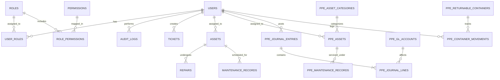

# Database Schema Reference
## Unified ITMS + PPE Relational Data Model

---

## 1. Schema Overview

The unified database schema merges IT operational management and capital property accounting into a consolidated relational model. The schema is organized into three major sections:
1. **Shared Platform Core**: Identity, authentication, role-based access control, system settings, and audit logs.
2. **ITMS Domain**: IT equipment, ticketing, repair logs, licenses, spare parts, and network endpoints.
3. **PPE Domain**: Property, plant and equipment, straight-line depreciation, Chart of Accounts, double-entry journal vouchers, and returnable containers.

---

## 2. Entity Relationship Diagram (ERD)

---

## 3. Detailed Table Specifications

### 3.1. Shared Platform Core Tables

#### `users`
Central user registry supporting authentication for both IT operations and accounting staff.
- `id` (INTEGER / BIGINT, PK, Auto-Increment)
- `username` (VARCHAR(100), UNIQUE, NOT NULL)
- `email` (VARCHAR(150), UNIQUE, NOT NULL)
- `password` (VARCHAR(255), NOT NULL) - Salted bcrypt hash
- `full_name` (VARCHAR(150), NULL)
- `department` (VARCHAR(100), NULL)
- `position` (VARCHAR(100), NULL)
- `phone` (VARCHAR(50), NULL)
- `status` (VARCHAR(20), DEFAULT 'ACTIVE') - `ACTIVE`, `INACTIVE`, `SUSPENDED`
- `force_password_change` (BOOLEAN, DEFAULT 0)
- `created_at` (DATETIME, DEFAULT CURRENT_TIMESTAMP)
- `updated_at` (DATETIME, DEFAULT CURRENT_TIMESTAMP)

#### `roles`
System access tiers.
- `id` (INTEGER, PK, Auto-Increment)
- `name` (VARCHAR(50), UNIQUE, NOT NULL) - `SUPER_ADMIN`, `ADMIN`, `STAFF`, `USER`
- `description` (TEXT, NULL)
- `created_at` (DATETIME)

#### `permissions`
Granular authorization capabilities.
- `id` (INTEGER, PK, Auto-Increment)
- `name` (VARCHAR(100), UNIQUE, NOT NULL) - e.g. `ppe.assets.create`, `assets.view`
- `module` (VARCHAR(50), NOT NULL) - e.g. `PPE`, `Assets`, `Tickets`
- `description` (TEXT, NULL)

#### `role_permissions`
Many-to-many permission assignment matrix.
- `role_id` (INTEGER, FK -> `roles.id`, CASCADE)
- `permission_id` (INTEGER, FK -> `permissions.id`, CASCADE)
- Primary Key: `(role_id, permission_id)`

#### `user_roles`
User assignment to security roles.
- `user_id` (INTEGER, FK -> `users.id`, CASCADE)
- `role_id` (INTEGER, FK -> `roles.id`, CASCADE)
- Primary Key: `(user_id, role_id)`

#### `audit_logs`
Immutable compliance and security trail.
- `id` (INTEGER, PK, Auto-Increment)
- `user_id` (INTEGER, FK -> `users.id`, SET NULL)
- `username` (VARCHAR(100), NULL)
- `action` (VARCHAR(100), NOT NULL)
- `module` (VARCHAR(50), NOT NULL)
- `record_id` (VARCHAR(100), NULL)
- `ip_address` (VARCHAR(45), NULL)
- `user_agent` (TEXT, NULL)
- `old_values` (JSON / TEXT, NULL)
- `new_values` (JSON / TEXT, NULL)
- `created_at` (DATETIME, DEFAULT CURRENT_TIMESTAMP)

---

### 3.2. PPE (Property, Plant, and Equipment) Tables

#### `ppe_asset_categories`
Classification and standard accounting lifetimes.
- `id` (INTEGER, PK, Auto-Increment)
- `name` (VARCHAR(100), NOT NULL, UNIQUE)
- `code` (VARCHAR(20), NOT NULL, UNIQUE) - e.g., `MACH`, `VEH`, `BLDG`
- `useful_life_years` (DECIMAL(4,1), NOT NULL, DEFAULT 5.0)
- `default_salvage_percentage` (DECIMAL(5,2), NOT NULL, DEFAULT 10.00)
- `description` (TEXT, NULL)
- `created_at`, `updated_at` (DATETIME)

#### `ppe_assets`
Fixed asset capital inventory with continuous depreciation tracking.
- `id` (INTEGER, PK, Auto-Increment)
- `asset_code` (VARCHAR(50), NOT NULL, UNIQUE) - Format `PPE-YYYY-0001`
- `category_id` (INTEGER, NOT NULL, FK -> `ppe_asset_categories.id`)
- `name` (VARCHAR(150), NOT NULL)
- `description` (TEXT, NULL)
- `model` (VARCHAR(100), NULL)
- `serial_number` (VARCHAR(100), NULL)
- `status` (VARCHAR(50), NOT NULL, DEFAULT 'ACTIVE') - `ACTIVE`, `UNDER_MAINTENANCE`, `DISPOSED`, `FULLY_DEPRECIATED`
- `location` (VARCHAR(150), NULL)
- `department` (VARCHAR(100), NULL)
- `custodian_id` (INTEGER, NULL, FK -> `users.id`, SET NULL)
- `custodian_name` (VARCHAR(150), NULL)
- `purchase_date` (DATE, NOT NULL)
- `acquisition_cost` (DECIMAL(14,2), NOT NULL)
- `salvage_value` (DECIMAL(14,2), NOT NULL, DEFAULT 0.00)
- `useful_life_years` (DECIMAL(4,1), NOT NULL)
- `accumulated_depreciation` (DECIMAL(14,2), NOT NULL, DEFAULT 0.00)
- `net_book_value` (DECIMAL(14,2), NOT NULL)
- `photo_url` (VARCHAR(255), NULL)
- `qr_code` (TEXT, NULL)
- `notes` (TEXT, NULL)
- `created_at`, `updated_at` (DATETIME)
- *Indexes*: `(status)`, `(category_id)`, `(purchase_date)`

#### `ppe_asset_code_counters`
Thread-safe, year-scoped atomic sequential code counters.
- `year` (INTEGER, PK)
- `last_seq` (INTEGER, NOT NULL, DEFAULT 0)

#### `ppe_gl_accounts`
Chart of Accounts for double-entry bookkeeping.
- `id` (INTEGER, PK, Auto-Increment)
- `code` (VARCHAR(20), NOT NULL, UNIQUE) - e.g., `1500`, `1510`, `5200`
- `name` (VARCHAR(100), NOT NULL)
- `type` (VARCHAR(20), NOT NULL) - `ASSET`, `LIABILITY`, `EQUITY`, `REVENUE`, `EXPENSE`
- `description` (TEXT, NULL)
- `balance` (DECIMAL(14,2), NOT NULL, DEFAULT 0.00)
- `created_at`, `updated_at` (DATETIME)

#### `ppe_journal_entries`
Double-entry Journal Vouchers (JVs).
- `id` (INTEGER, PK, Auto-Increment)
- `entry_number` (VARCHAR(50), NOT NULL, UNIQUE) - Format `JV-YYYYMM-0001`
- `entry_date` (DATE, NOT NULL)
- `reference` (VARCHAR(100), NULL) - e.g., `Depreciation Run - 2026-03`
- `description` (TEXT, NOT NULL)
- `total_debit` (DECIMAL(14,2), NOT NULL)
- `total_credit` (DECIMAL(14,2), NOT NULL)
- `status` (VARCHAR(20), NOT NULL, DEFAULT 'POSTED')
- `created_by` (INTEGER, NULL, FK -> `users.id`, SET NULL)
- `created_at` (DATETIME)
- *Constraint*: `total_debit == total_credit`

#### `ppe_journal_lines`
Individual debit and credit postings.
- `id` (INTEGER, PK, Auto-Increment)
- `journal_id` (INTEGER, NOT NULL, FK -> `ppe_journal_entries.id`, CASCADE)
- `account_id` (INTEGER, NOT NULL, FK -> `ppe_gl_accounts.id`)
- `debit` (DECIMAL(14,2), NOT NULL, DEFAULT 0.00)
- `credit` (DECIMAL(14,2), NOT NULL, DEFAULT 0.00)
- `description` (VARCHAR(255), NULL)

#### `ppe_returnable_containers`
Reusable transport packaging (pallets, totes, gas cylinders, bins).
- `id` (INTEGER, PK, Auto-Increment)
- `container_code` (VARCHAR(50), NOT NULL, UNIQUE)
- `type` (VARCHAR(50), NOT NULL) - `PLASTIC_PALLET`, `WOODEN_PALLET`, `STEEL_CRATE`, `IBC_TOTE`
- `status` (VARCHAR(50), NOT NULL, DEFAULT 'AVAILABLE') - `AVAILABLE`, `ASSIGNED`, `IN_TRANSIT`, `DAMAGED`, `RETIRED`
- `current_location` (VARCHAR(150), NULL)
- `assigned_party` (VARCHAR(150), NULL)
- `notes` (TEXT, NULL)
- `created_at`, `updated_at` (DATETIME)

#### `ppe_container_movements`
Movement and custody transfer history.
- `id` (INTEGER, PK, Auto-Increment)
- `container_id` (INTEGER, NOT NULL, FK -> `ppe_returnable_containers.id`, CASCADE)
- `movement_type` (VARCHAR(50), NOT NULL) - `CHECK_OUT`, `CHECK_IN`, `TRANSFER`, `STATUS_CHANGE`
- `from_location` (VARCHAR(150), NULL)
- `to_location` (VARCHAR(150), NULL)
- `handled_by` (INTEGER, NULL, FK -> `users.id`, SET NULL)
- `movement_date` (DATETIME, NOT NULL, DEFAULT CURRENT_TIMESTAMP)
- `notes` (TEXT, NULL)

---

### 3.3. ITMS Domain Tables

#### `assets`
IT hardware units and workstations.
- `id` (INTEGER, PK, Auto-Increment)
- `asset_tag` (VARCHAR(50), UNIQUE, NOT NULL)
- `name` (VARCHAR(100), NOT NULL)
- `category` (VARCHAR(50), NOT NULL) - `Laptop`, `Desktop`, `Server`, `Network`, `Radio`
- `brand` (VARCHAR(50), NULL)
- `model` (VARCHAR(50), NULL)
- `serial_number` (VARCHAR(100), NULL)
- `status` (VARCHAR(30), DEFAULT 'Available')
- `assigned_to` (INTEGER, FK -> `users.id`, SET NULL)
- `department` (VARCHAR(50), NULL)
- `location` (VARCHAR(100), NULL)
- `purchase_date` (DATE, NULL)
- `warranty_expiry` (DATE, NULL)
- `image_path` (VARCHAR(255), NULL)
- `created_at`, `updated_at` (DATETIME)

#### `tickets`
IT help desk incidents and service tickets.
- `id` (INTEGER, PK, Auto-Increment)
- `ticket_number` (VARCHAR(50), UNIQUE, NOT NULL)
- `title` (VARCHAR(150), NOT NULL)
- `description` (TEXT, NOT NULL)
- `priority` (VARCHAR(20), DEFAULT 'Medium') - `Low`, `Medium`, `High`, `Critical`
- `status` (VARCHAR(30), DEFAULT 'Open') - `Open`, `In Progress`, `Pending Parts`, `Resolved`, `Closed`
- `category` (VARCHAR(50), NULL)
- `requested_by` (INTEGER, FK -> `users.id`, SET NULL)
- `assigned_to` (INTEGER, FK -> `users.id`, SET NULL)
- `created_at`, `updated_at` (DATETIME)

#### Additional Supporting ITMS Tables
- `ticket_replies`: Discussion timeline on tickets.
- `repairs`: Hardware repair work orders, technician assignments, repair costs.
- `maintenance_records`: Preventive maintenance schedules and check logs.
- `inventory_items`: Spare parts and consumable supplies with stock quantity alerts.
- `licenses`: Software licenses, seats count, expiration dates, activation keys.
- `backups`: Database and server backup monitoring records.
- `endpoints`, `network_devices`, `printers`, `file_shares`, `guest_wifi`: IT infrastructure records.
