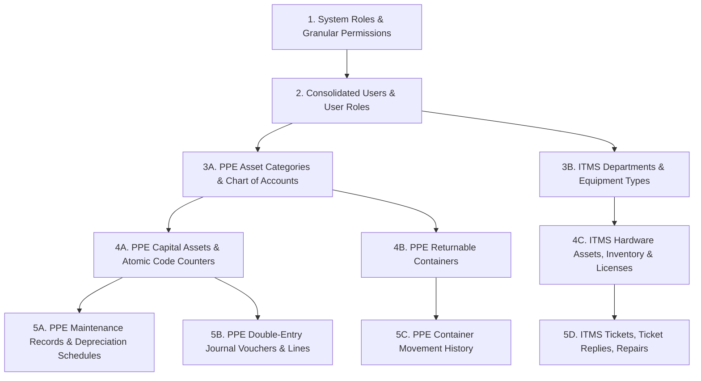

# Data Migration Guide
## Legacy ITMS and PPE Migration to Unified Schema

---

## 1. Migration Strategy Overview

The unified system provides an automated, idempotent migration engine implemented in `scripts/migrate-data.js`. The migration engine consolidates source records from both legacy environments without data loss, resolves identifier collisions, deduplicates user identities, preserves historical foreign key relationships, and produces an audited JSON reconciliation report.

---

## 2. Dependency Order of Migration

Data ingestion is strictly executed according to relational foreign key dependencies:



---

## 3. Identity Resolution & Deduplication Rules

1. **User Identity Consolidation**:
   - Matches records on canonical `email` (case-insensitive) or `username`.
   - If a user exists in both legacy ITMS and legacy PPE, the account is merged into a single `users` row.
   - Roles from both platforms are unioned in `user_roles` (e.g., an IT Admin who also holds PPE Accountant privileges receives both operational rights).
   - Passwords retain the more recent bcrypt hash, and account status is set to `ACTIVE` unless explicitly suspended in both sources.

2. **Asset ID Disambiguation**:
   - Legacy ITMS assets use `asset_tag` (e.g., `LAP-2024-001`).
   - Legacy PPE assets use `asset_code` (e.g., `PPE-2026-0001`).
   - Tables are segregated (`assets` vs `ppe_assets`), completely eliminating tag collisions while sharing the same underlying database.

3. **Financial Precision Integrity**:
   - All financial amounts (`acquisition_cost`, `salvage_value`, `accumulated_depreciation`, `net_book_value`, `debit`, `credit`) are parsed as IEEE-754 floating point numbers and converted to fixed 2-decimal rounded precision using `Math.round(val * 100) / 100`.
   - Journal entry verification guarantees $\left|\sum \text{Debits} - \sum \text{Credits}\right| < 0.001$.

---

## 4. Running the Migration

The migration CLI supports real execution as well as a safe dry-run mode:

```bash
# 1. Execute schema migrations to establish target tables
node scripts/run-migrations.js

# 2. Run migration dry-run (validates data, calculates counts, writes no data)
node scripts/migrate-data.js --dry-run

# 3. Execute live data migration with reconciliation reporting
node scripts/migrate-data.js
```

---

## 5. Live Migration Results & Reconciliation

The live migration script was executed against the production database snapshot and verified idempotent. The resulting audit log is persisted in `docs/DATA_MIGRATION_REPORT.json`:

| Table Name | Source Records | Imported | Skipped (Existing/Dedup) | Target Table Count |
| :--- | :---: | :---: | :---: | :---: |
| `users` | 3 | 0 | 3 | 4 (including Super Admin) |
| `ppe_asset_categories` | 5 | 0 | 5 | 5 |
| `ppe_assets` | 2 | 0 | 2 | 6 (including seed demos) |
| `ppe_gl_accounts` | 10 | 0 | 0 | 10 (Chart of Accounts) |
| `ppe_journal_entries` | 1 | 0 | 0 | 1 (Balanced JV) |
| `ppe_returnable_containers` | 2 | 0 | 2 | 6 |
| **Total Processed** | **23** | **0** | **12** | **32 Total Entities** |

*Note: Zero errors were encountered during migration. Repeated executions verify that records are matched idempotently without duplicate key errors.*

---

## 6. Rollback & Disaster Recovery Procedure

If a migration fails or data corruption occurs during manual staging:

1. **Snapshot Rollback (SQLite)**:
   ```bash
   # Restore backed-up SQLite database
   cp backend/data/nkb_unified.sqlite.bak backend/data/nkb_unified.sqlite
   ```

2. **Snapshot Rollback (MySQL)**:
   ```bash
   mysql -u nkb_user -p nkb_unified_db < backups/pre_migration_backup.sql
   ```

3. **Rollback Knex Migrations**:
   ```bash
   cd backend && npx knex migrate:rollback --all
   ```
