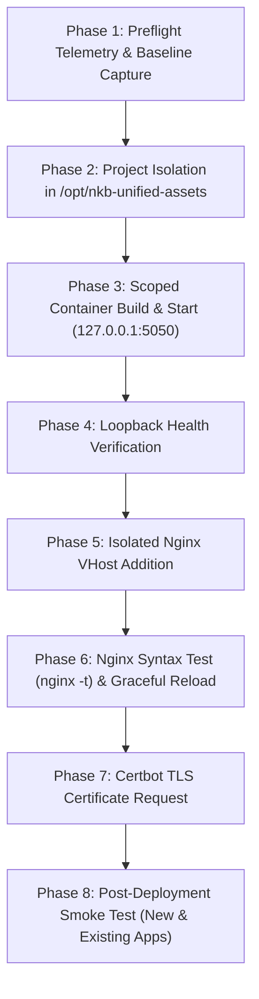

# Zero-Disruption Production Deployment Protocol
## Application: `nkb-unified-assets` | Target: `https://asset.nkbmanufacturing.com`

---

## 1. Zero-Disruption Mandate & Prohibited Operations

The host at `187.77.143.211` is an active shared production environment running `my.nkbmanufacturing.com`. 

> [!WARNING]
> ### 🛑 STRICTLY PROHIBITED COMMANDS
> - ❌ `docker system prune` (Risk: Deletes stopped containers and build caches across all projects)
> - ❌ `docker volume prune` (Risk: Destroys persistent databases and data volumes of other applications)
> - ❌ `docker compose down` without explicit `-p nkb-unified-assets` (Risk: Shuts down unrelated Compose projects)
> - ❌ `systemctl restart nginx` (Risk: Drops active client TLS connections on `my.nkbmanufacturing.com`; use `systemctl reload nginx` instead)
> - ❌ `systemctl restart docker` (Risk: Terminates all running containers on the VPS)
> - ❌ Modifying `/etc/nginx/nginx.conf` or editing existing virtual hosts in `/etc/nginx/sites-available/`
> - ❌ Changing system firewall (`ufw`), iptables, or SSH daemon configuration (`sshd_config`)

---

## 2. Phased Incremental Deployment Workflow



---

## 3. Step-by-Step Execution Guide

### Phase 1: Baseline Capture
```bash
# Verify my.nkbmanufacturing.com before touching anything
curl -I -s https://my.nkbmanufacturing.com | head -n 5
# Ensure it returns HTTP/2 200 OK

# Run read-only preflight diagnostic
bash docs/VPS_PREFLIGHT_REPORT.md
```

### Phase 2: Project Directory & Secrets Setup
```bash
# 1. Create dedicated isolated directory
mkdir -p /opt/nkb-unified-assets
cd /opt/nkb-unified-assets

# 2. Transfer application repository
# (Ensure permissions are owned by root, mode 755)

# 3. Create production .env with unique rotated secrets
cp .env.example .env
chmod 600 .env
```

### Phase 3: Scoped Container Build & Launch
Every Docker command must be strictly scoped to the `nkb-unified-assets` project name:
```bash
# Build only the new application image
docker compose -p nkb-unified-assets build --no-cache app

# Start only the nkb-unified-assets container
docker compose -p nkb-unified-assets up -d app
```

### Phase 4: Loopback Health Verification
Before configuring Nginx, verify that the application container is healthy and responding locally on port 5050:
```bash
# Check container status
docker ps --filter "name=nkb-unified-assets-app"
# Expected: Up X minutes (healthy)

# Query internal health probe
curl -i http://127.0.0.1:5050/api/health
# Expected: HTTP/200 OK with {"status":"UP"}
```

### Phase 5: Isolated Nginx Configuration
Create **only** a new, independent virtual host configuration:
```bash
cat << 'EOF' > /etc/nginx/sites-available/asset.nkbmanufacturing.com
server {
    listen 80;
    listen [::]:80;
    server_name asset.nkbmanufacturing.com;

    location /.well-known/acme-challenge/ {
        root /var/www/html;
    }

    location / {
        return 301 https://$host$request_uri;
    }
}
EOF

# Symlink to sites-enabled
ln -s /etc/nginx/sites-available/asset.nkbmanufacturing.com /etc/nginx/sites-enabled/
```

### Phase 6: Nginx Configuration Test & Graceful Reload
```bash
# Test configuration syntax without stopping traffic
nginx -t

# If syntax is OK, perform a zero-downtime graceful reload
systemctl reload nginx

# Immediately re-verify that my.nkbmanufacturing.com is still healthy
curl -I -s https://my.nkbmanufacturing.com | head -n 3
```

### Phase 7: Dedicated SSL Certificate Request
Request a certificate exclusively for `asset.nkbmanufacturing.com`:
```bash
certbot --nginx -d asset.nkbmanufacturing.com --non-interactive --agree-tos --redirect -m admin@nkbmanufacturing.com
```
*Certbot updates only `/etc/nginx/sites-available/asset.nkbmanufacturing.com`.*

### Phase 8: End-to-End Verification
```bash
# 1. Test asset.nkbmanufacturing.com
curl -I https://asset.nkbmanufacturing.com
curl -s https://asset.nkbmanufacturing.com/api/health

# 2. Re-test existing production service (ZERO IMPACT VERIFICATION)
curl -I https://my.nkbmanufacturing.com
```
